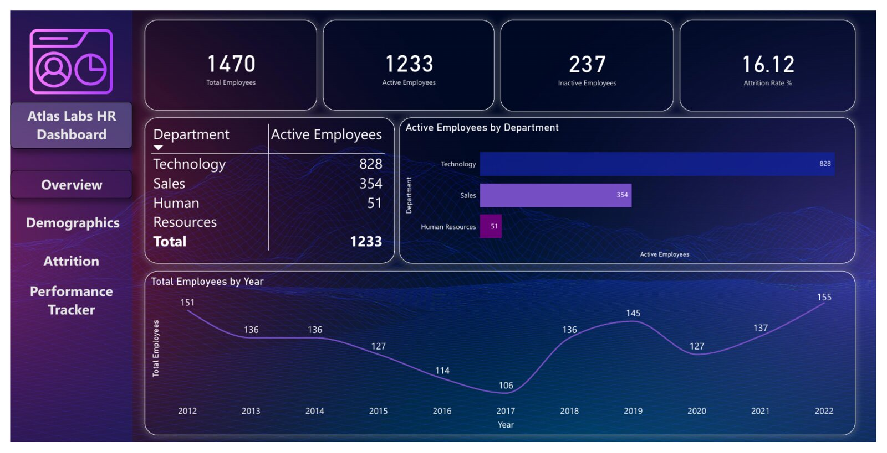
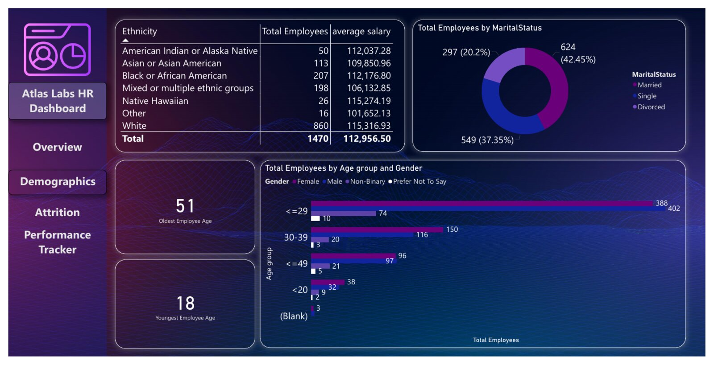
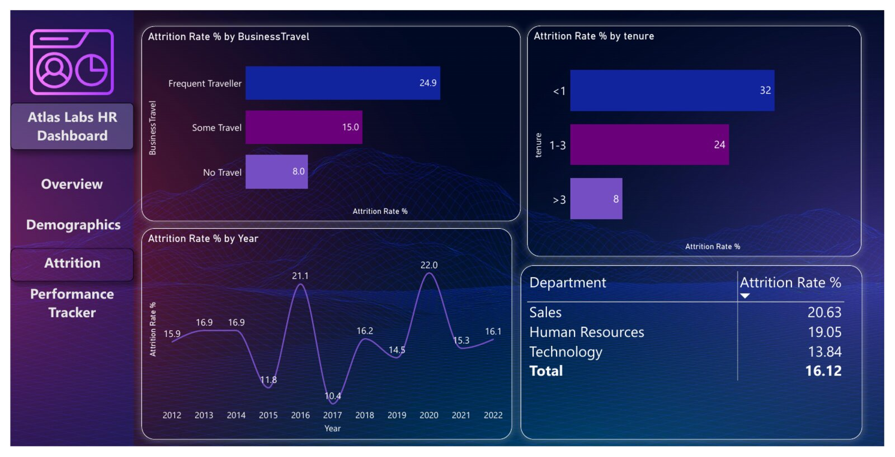
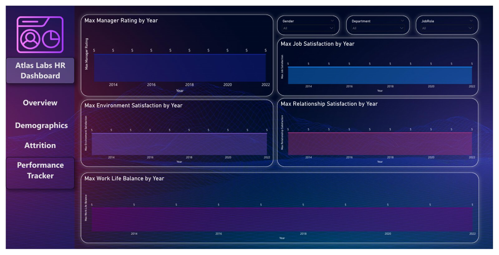
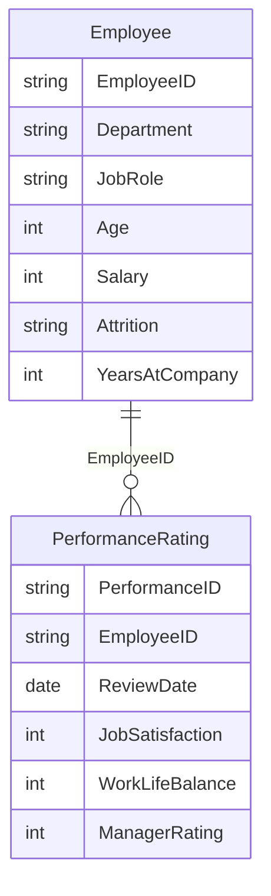

# Atlas Labs HR Analytics Dashboard (Power BI)

An interactive Power BI dashboard that helps HR teams and business leaders understand workforce size, attrition, demographics, salaries and employee satisfaction for the fictional company Atlas Labs.




## Business questions

This project was built as a team effort to analyze employee data and provide actionable insights into workforce demographics, attrition and performance trends. The dashboard answers:

- How large is the workforce and how is it distributed across departments?
- How does attrition change over time, by department and by tenure?
- What does the workforce look like by age, gender, marital status and ethnicity?
- How do salaries compare across employee groups?
- How satisfied are employees, and how do managers rate them?

## What the dashboard shows

Figures below are read directly from the dashboard pages in this repository (sample, anonymized HR dataset).

| Metric | Value |
|---|---|
| Total employees | 1,470 |
| Active employees | 1,233 |
| Inactive employees | 237 |
| Overall attrition rate | 16.12% |

- **Sales** has the highest attrition rate of the three departments (20.63%), ahead of Human Resources (19.05%) and Technology (13.84%).
- **Frequent travellers** leave at a much higher rate (24.9%) than employees who travel rarely (15.0%) or not at all (8.0%).
- **New joiners** are most at risk: attrition is 32% for employees with less than one year at the company, 24% for one to three years and 8% after three years.

## Dashboard pages

| Page | Content |
|---|---|
| **Overview** | Headline KPIs, active employees by department, total employees by hiring year |
| **Demographics** | Headcount and average salary by ethnicity, marital status, age group and gender, youngest and oldest employee |
| **Attrition** | Attrition rate by business travel, tenure, year and department |
| **Performance Tracker** | Manager rating, job, environment and relationship satisfaction, and work-life balance by year, with gender, department and job role filters |

<details>
<summary>Screenshots of the other pages</summary>





</details>

## Data model

Five Excel tables: one employee table, one performance review table linked to it by `EmployeeID`, and three lookup tables that translate numeric codes into labels.



| File | Rows | Description |
|---|---|---|
| `Employee.xlsx` | 1,470 | Demographics, department, role, salary, hire date, attrition, tenure |
| `PerformanceRating.xlsx` | 6,709 | Yearly reviews: satisfaction scores, training, self and manager rating |
| `EducationLevel.xlsx` | 5 | Education level lookup |
| `SatisfiedLevel.xlsx` | 5 | Satisfaction level lookup |
| `RatingLevel.xlsx` | 5 | Rating level lookup |

## Key DAX measures

The full list is in [`DAX Measure Of HR Dashboard.pdf`](DAX%20Measure%20Of%20HR%20Dashboard.pdf).

```DAX
Total Employees    = COUNT(Employee[EmployeeID])
Active Employees   = CALCULATE([Total Employees], Employee[Attrition] = "No")
Inactive Employees = CALCULATE([Total Employees], Employee[Attrition] = "Yes")
Attrition Rate %   = DIVIDE([Inactive Employees], [Total Employees] / 100)
```

Calculated columns group employees into age bands (`AgeGroup`) and tenure bands (`tenure`: under 1 year, 1 to 3 years, over 3 years).

## Tools and technologies

- **Power BI** for data modelling, visualization and page navigation
- **DAX** for measures, KPIs and calculated columns
- **Excel** as the data source

## How to open

1. Install [Power BI Desktop](https://powerbi.microsoft.com/desktop/) (Windows).
2. Download `HR_Data_Analytics.1[1]_finall[1].pbix` and open it.
3. If Power BI asks for the data source, point it to the five `.xlsx` files in this repository.

No Power BI? See the exported report in [`HR_Data_Analytics.1.pdf`](HR_Data_Analytics.1.pdf).

## Repository contents

```
HR_Data_Analytics.1[1]_finall[1].pbix   Power BI report
HR_Data_Analytics.1.pdf                 PDF export of the four dashboard pages
DAX Measure Of HR Dashboard.pdf         All DAX measures used
*.xlsx                                  Source tables
images/                                 Screenshots used in this README
```

---

📫 Lina Amer · [LinkedIn](https://www.linkedin.com/in/linaamer1) · [linaamer1312@gmail.com](mailto:linaamer1312@gmail.com)
